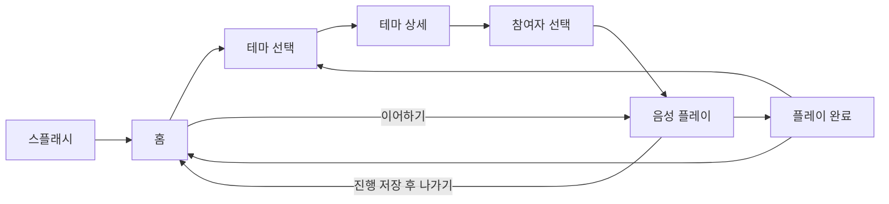
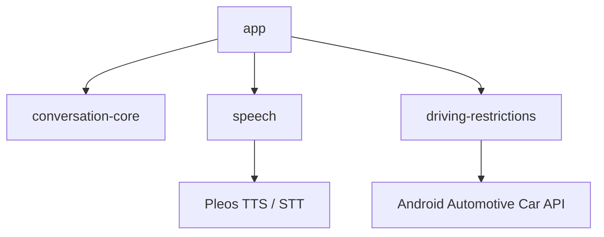

<div align="center">
  
  <h1>어쩌다 동승 · ChanceRide</h1>
  <p><strong>대화도 게임도, 말로 함께 즐겨요.</strong></p>
  <p>Pleos Connect에서 운전자와 동승자가 함께하는 한국어 음성 대화 앱</p>
</div>

---

## 프로젝트 소개

이동 시간을 함께 이야기하는 시간으로 바꾸는 차량용 대화·미니게임 앱입니다.
정차 중 테마와 참여 좌석을 선택하고, 플레이가 시작되면 질문을 듣고 음성으로 다음 질문을 진행할 수 있습니다.

현대자동차 Pleos 공모전 제출을 위한 **작동하는 프로토타입**입니다.
현재 7개 테마에 각각 10개 질문을 제공하며, 질문 콘텐츠는 앱에 포함되어 있습니다.

## 주요 기능

| 기능 | 동작 |
| --- | --- |
| 테마 선택 | 스몰 토크, 유머러스, 로맨틱, 오늘의 이야기, 이심전심, 밸런스 게임, 여행의 순간 |
| 참여자 선택 | 운전석·조수석·뒷좌석 중 2~4석을 직접 선택 |
| 한국어 음성 플레이 | 질문 읽기 → 발화 인식 → 명령 실행 또는 대화 기록 |
| 이어하기 | 질문 위치·참여 좌석·대화·누적 시간을 기기에 저장 |
| 대화 말풍선 | 최종 인식된 발화를 표시하며, 주행 UX 규제 시 숨김 |
| 플레이 완료 | 방문한 질문 수와 함께한 시간을 요약하고 다시 시작 |
| 차량 UX 연동 | 실제 플랫폼 규제에 따라 설정·원문 표시·터치 탐색 제한 |



## 실행하기

### 준비 환경

| 항목 | 설정 |
| --- | --- |
| 실행 대상 | Pleos Connect 2.1.0 / Android Automotive |
| 언어·화면 | Kotlin, Android Views, AppCompat |
| Android SDK | compileSdk 37 · targetSdk 37 · minSdk 34 |
| Android Gradle Plugin | 9.5.1, 내장 Kotlin 지원 사용 |
| Gradle | Wrapper 9.6.0 포함 |
| Gradle JVM | JDK 25 — 저장소의 Daemon JVM 설정 기준 |
| Pleos 음성 SDK | TTS 3.3.1 · STT 3.3.1 |

### 개발·테스트 에뮬레이터와 화면 규격

| 항목 | 개발에 사용한 설정 |
| --- | --- |
| 에뮬레이터 | Pleos Connect v2.1.0 |
| AVD 이름 | `Pleos_Connect_v2.1.0` |
| 시스템 이미지 | Android 14 / API 34 · `pleos_car_emulator` · ARM64 (`arm64-v8a`) |
| 주 디스플레이 해상도 | **2560 × 1440px** (가로) |
| 주 디스플레이 밀도 | **160dpi** |
| 앱 화면 방향 | portrait |
| 앱 레이아웃 기준 | **840 × 1180** — 시안의 앱 영역을 나타내는 기준 좌표 |

위 해상도와 밀도는 개발에 사용한 AVD의 설정값입니다.
앱에 할당되는 실제 창 크기는 차량 런처와 시스템 UI에 따라 달라지며,
앱은 시스템 바·컷아웃을 제외한 영역에 세로 레이아웃을 동일 배율로 맞춥니다.
`840 × 1180`은 에뮬레이터의 물리 해상도가 아닙니다.

음성 테스트에는 에뮬레이터의 마이크 입력과 Pleos 한국어 음성 엔진이 필요합니다.
앱의 마이크 권한을 허용하고, 테마·참여자 선택은 정차 및 UX 규제 해제 상태에서 진행합니다.
실제 발화 확인 절차와 자동 테스트 결과는 [검증 문서](docs/TESTING.md)를 참고하세요.

### 빌드 및 실행 순서

1. 저장소를 내려받고 Android Studio에서 루트 폴더를 엽니다.
2. 위 AGP 버전을 지원하는 Android Studio와 Android SDK Platform 37을 준비합니다.
3. Gradle Sync를 실행합니다. AndroidX와 Pleos Maven 저장소에 접근할 수 있어야 합니다.
4. Pleos Connect 2.1.0 에뮬레이터 또는 지원 기기를 실행합니다.
5. 실행 모듈 **app**을 선택하고 Run합니다.
6. 정차 상태에서 테마·참여자를 선택한 뒤 마이크 권한을 허용합니다.

로컬 SDK 경로는 Android Studio가 생성하는 `local.properties`로 설정합니다.
개인 경로·서명 키·빌드 결과는 Git에 포함하지 않습니다.
Pleos SDK는 아래 저장소에서 Gradle 의존성으로 가져오며, SDK 바이너리를 이 저장소에 복사하지 않습니다.

```text
https://nexus-playground.pleos.ai/repository/maven-releases/
```

터미널 빌드:

```bash
./gradlew :app:assembleDebug
```

Debug APK 출력: `app/build/outputs/apk/debug/app-debug.apk`

### 제출용 Release APK

**다운로드: [apk/ChanceRide-release.apk](apk/ChanceRide-release.apk)**

제출 APK는 Release 빌드이며 로컬 Release 키로 서명했습니다.
`debuggable=false`이고 API 34 이상의 Pleos Connect 환경을 대상으로 합니다.
키 파일과 비밀번호는 Git에 포함하지 않으며, 제출용 `apk/*.apk`만 추적하도록 설정했습니다.

같은 서명으로 다시 만들 때는 로컬 `signing.properties`와 키를 유지한 상태에서 실행합니다.

```bash
./gradlew :app:packageSubmissionApk
```

서명 설정 형식은 [signing.properties.example](signing.properties.example),
설치 방법은 [APK 안내](apk/README.md)를 참고하세요.
다른 개발 환경에서는 본인의 서명 키와 실제 비밀번호를 준비해야 합니다.
새 키로 빌드한 APK는 기존 Debug 앱에 덮어쓸 수 없으므로 별도 에뮬레이터 사용을 권장합니다.

일반 휴대폰 에뮬레이터에서는 차량 서비스와 Pleos 음성 엔진을 사용할 수 없습니다.
Pleos 엔진 준비 여부와 마이크 입력은 지원 환경에서 확인해야 합니다.

## 음성 사용법

| 말하기 | 처리 |
| --- | --- |
| “다음”, “다음 질문” | 다음 질문. 마지막 질문에서는 플레이 완료 |
| “이전”, “이전 질문”, “뒤로” | 이전 질문 |
| “다시”, “다시 읽어줘” | 현재 질문 다시 읽기 |
| “나가기”, “그만”, “홈으로” | 진행 상태를 저장하고 홈으로 복귀 |
| “완료”, “대화 완료” | 플레이 완료 |

- “어쩌다 동승 다음”처럼 앱 이름을 붙인 명령도 처리합니다.
- “다음에 또 만나자” 같은 일반 문장은 탐색 명령으로 처리하지 않습니다.
- TTS가 끝난 뒤 STT를 시작합니다. 안내 재생 중의 대화는 기록하지 않습니다.
- 연속 녹음 방식이 아닌, 발화 단위 인식을 반복하는 구조입니다.
- 음성을 중단하거나 다시 시작하려면 **플레이 상단 제목을 길게 눌러** 음성 제어 메뉴를 엽니다.
- 진행 중인 대화가 있어도 새 플레이 시작 시 확인창 없이 새로운 세션으로 교체합니다.

## Pleos와 차량 API 활용

| SDK / API | 적용 |
| --- | --- |
| `ai.pleos.playground:TextToSpeech:3.3.1` | 한국어 질문 안내, ON_DEVICE 모드, 재생 콜백 |
| `ai.pleos.playground:SpeechToText:3.3.1` | 한국어 명령·대화의 최종 인식 결과 처리, ON_DEVICE 모드 |
| `AudioManager` · `AudioFocusRequest` | TTS 전 일시적 포커스 요청, 상실 시 중단, 완료·오류 시 반환 |
| `CarUxRestrictionsManager` | 실제 차량 UX 규제 초기값 조회 및 변경 구독 |
| Activity 생명주기 · 화면 상태 이벤트 | 백그라운드·화면 꺼짐 시 음성 중단 및 자원 정리 |

오디오 포커스는 `USAGE_ASSISTANT`, `CONTENT_TYPE_SPEECH`,
`AUDIOFOCUS_GAIN_TRANSIENT_MAY_DUCK`으로 요청합니다.
다른 오디오와의 재생·감쇠 관계는 차량 정책에 따릅니다.
포커스를 잃은 뒤에는 앱이 임의로 안내를 재생하지 않습니다.

### 주행 중 동작

홈·테마·참여자 선택은 정차 중 설정하는 화면입니다.
기어 P 여부를 자체 추정하는 대신, 플랫폼의 최신 UX 규제를 기준으로 조작을 허용합니다.
연결 실패·조회 전·연결 종료 상태도 설정 조작을 허용하지 않습니다.

음성 중심 `PlayActivity`에만 `distractionOptimized=true`를 선언했습니다.
이는 OEM의 적합성 검증이나 승인을 대신하지 않습니다.
주행 규제가 활성화되면 질문·대화 원문을 제한하고 질문 탐색 터치를 비활성화합니다.
음성 명령 처리와 원문 텍스트 표시는 별도로 제어합니다.

상세 정책은 [아키텍처 문서](docs/ARCHITECTURE.md)를 참고하세요.

## 코드 구조

```text
ChanceRide/
├── app/                    # 화면 흐름, 로컬 저장, 앱 생명주기
├── conversation-core/      # 세션·질문·좌석·음성 명령 규칙
├── speech/                 # Pleos TTS/STT, 음성 루프, 오디오 포커스
├── driving-restrictions/   # AAOS UX 규제 구독과 기능 정책
├── docs/                   # 구조 및 검증 문서
└── gradle/                 # 버전 카탈로그와 Gradle Wrapper
```



음성·주행 규제·대화 규칙을 화면에서 분리하여 단위 테스트합니다.
UI는 디자이너 시안의 앱 영역을 기준으로 한 세로 레이아웃이며,
기본 portrait 방향과 동일 배율 크기 조정을 사용합니다.
실제 PNG 아이콘은 [디자인 자산 폴더](app/src/main/assets/design)에 포함되어 있습니다.

## 대화 데이터

- 최종 인식된 **텍스트**를 앱 전용 SharedPreferences에 저장합니다.
- 원본 음성 파일을 저장하지 않으며, 앱이 대화 텍스트를 서버로 전송하지 않습니다.
- 진행 중 대화 1개와 최근 완료 대화 1개를 보관합니다.
- 대화당 최근 500개 발화, 발화당 최대 2,000 UTF-16 문자를 저장합니다.
- 화자를 자동 분리하지 않습니다. “조수석 오늘 기분이 좋아요”처럼 **선택한 좌석을 명시**한 발화만 해당 좌석으로 표시합니다.
- **홈의 빈 배경을 길게 누르면** 기록 메뉴가 열립니다. “저장된 기록 삭제”에서 전체 기록을 삭제할 수 있습니다.
- 앱 백업과 기기 이전에서 대화 저장소를 제외했습니다.

## 검증과 후속 개발

Debug·Release 빌드, 네 모듈 Lint와 단위 테스트 23개를 확인했습니다.
검사 명령과 기기 검증 항목은 [검증 문서](docs/TESTING.md)에 정리했습니다.
GitHub Actions 워크플로는 빌드·Lint·단위 테스트용으로 포함했으며, GitHub 원격 실행 결과는 아직 없습니다.
테스트용 저장소를 주입해 사용자 대화 기록과 기기 테스트 데이터를 분리합니다.

현재 프로토타입의 후속 검증 범위는 다음과 같습니다.

- 실제 차량의 IGN·pre-suspend 전원 신호 연결과 복귀 시나리오
- 실차 소음·동승자 동시 발화 환경에서 한국어 인식 품질
- OEM 주행 UX 검증 및 규제 전환 중 화면·음성 동작
- 실제 주행 환경과 플랫폼 정책에 맞춘 콘텐츠·상호작용 검토

현재 화면 꺼짐·생명주기 기반 자원 정리와 Suspend 진입점은 연결되어 있습니다.
실차 전원 연동, 끊김 없는 녹음, 자동 좌석·화자 판별이 구현된 것으로 설명하지 않습니다.
