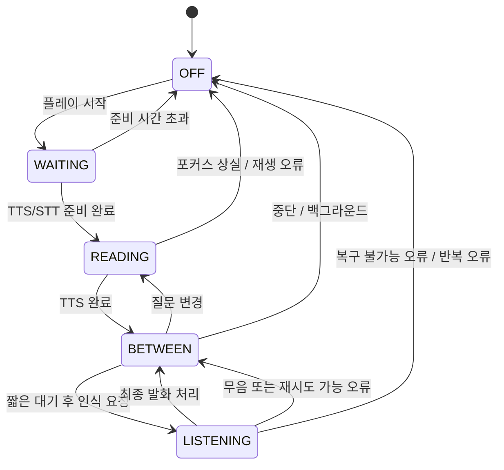

# Architecture

## 경계와 의존성

`app`이 세 개의 라이브러리 모듈을 조합합니다.
라이브러리 모듈끼리는 의존하지 않습니다.

| 모듈 | 책임 | 주요 진입점 |
| --- | --- | --- |
| app | 화면, 권한 요청, 세션 저장, 생명주기 | MainActivity, PlayActivity, SessionStore |
| conversation-core | 대화 데이터와 순수 상태 전이 | PlaySession, PlayCommandParser, ThemeCatalog |
| speech | SDK 연결, 발화 순서, 포커스 수명 | KoreanSpeechController, HandsFreeLoop |
| driving-restrictions | 차량 UX 규제 연결과 기능별 허용 판단 | CarDrivingRestrictionsMonitor, DrivingRestrictionsState |

`conversation-core`는 Android 라이브러리로 빌드하지만, 도메인 코드에 Android API를 사용하지 않습니다.
UI 없이 명령 해석·질문 이동·기록 상한·스냅샷 유효성을 테스트할 수 있습니다.

## 음성 상태 전이

`SpeechEvent`는 SDK 이벤트를 앱에 전달합니다.
텍스트 상태 메시지의 내용을 비교해서 재생 완료 여부를 판단하지 않습니다.

TTS와 STT는 반이중 방식으로 번갈아 실행합니다.
TTS 완료 후 450ms, 최종 발화 처리 후 650ms를 두고 다음 인식을 요청합니다.
무음은 재시도하고, 일반 오류는 대기 시간을 늘리며 5회 연속 실패 시 중단합니다.
세대 번호로 이미 취소된 요청의 콜백과 예약 작업을 무효화합니다.

`TtsPlaybackSession`이 안내 한 번과 오디오 포커스의 수명을 함께 관리합니다.
포커스를 얻기 전에 재생하지 않으며, 완료·중단·오류·타임아웃에는 반환합니다.
포커스 GAIN 이벤트만으로 중단된 안내를 재시작하지 않습니다.

## 주행 UX 정책

`Car.createCar`로 해당 Activity의 디스플레이에 연결하고,
`CarUxRestrictionsManager`의 초기값과 변경 콜백을 구독합니다.

| 상태 | 설정 탐색 | 질문·대화 원문 | 이전·다음 터치 |
| --- | --- | --- | --- |
| 최신 규제 수신, DO 불필요 | 허용 | 개별 플래그에 따라 표시 | 허용 |
| DO 필요 | 차단 | 숨김 / 단순 안내로 대체 | 차단 |
| 조회 전·연결 실패·중단 | 차단 | 숨김 / 단순 안내로 대체 | 차단 |

`NO_VOICE_TRANSCRIPTION`, `NO_TEXT_MESSAGE`, `LIMIT_STRING_LENGTH`를 표시 정책에 반영합니다.
음성 명령 실행과 화면 원문 노출은 별개입니다.
플랫폼이 설정 Activity를 차단하는 동작과 앱 내부의 기능 제한도 별개입니다.

플레이 Activity만 DO를 선언합니다.
이를 주행 규제 해제나 OEM 검증 완료로 해석하지 않습니다.
진행 중 테마·좌석 변경을 제공하지 않으며, 완료 후 테마 변경·재시작도 정차 정책을 따릅니다.

## 저장 형식과 복원

`SessionStore`의 JSON format version은 1입니다.
저장 필드는 세션 ID, 테마 ID, 좌석, 질문 인덱스, 누적 시간, 방문 질문,
대화 텍스트·화자·발화 시점, 완료 여부입니다.

읽을 때 도메인 유효성을 검사하며 잘못된 항목만 제거합니다.
앱 종료나 새 빌드 설치 시 기존의 정상적인 version 1 데이터는 유지합니다.
누적 시간은 전경에서 계산하고 주기적으로 저장하므로,
강제 프로세스 종료에서는 마지막 저장 이후 몇 초가 누락될 수 있습니다.

일반 대화의 화자는 자동 추정하지 않습니다.
명시한 좌석 이름을 긴 이름부터 검사하여 “운전석 뒤”를 “운전석”으로 잘못 귀속하지 않습니다.

## 생명주기

화면이 백그라운드로 가면 음성을 멈추고, 화면 꺼짐 시에는 SDK 자원을 해제합니다.
화면 켜짐은 연결 준비만 복구하며 자동 재생·마이크 재개를 하지 않습니다.
같은 프로세스의 화면 재생성에서는 ViewModel에 보관한 이전 음성 활성 상태를 사용합니다.

실제 차량의 IGN·pre-suspend 신호는 아직 연결하지 않았습니다.
현재의 화면 이벤트 처리와 실차 전원 제어 연동을 구분해 검증합니다.

## 화면과 자산

시안의 기기 테두리를 제외한 840×1180 좌표를 사용합니다.
폰트·아이콘·버튼을 따로 축소하지 않고 콘텐츠 전체에 같은 배율을 적용합니다.
시스템 바와 컷아웃 영역을 제외하고 배치하며 플레이 대화 영역은 독립적으로 스크롤합니다.

`ui/Design`은 View 생성과 배치를, `RideActivity`는 표시 영역을,
`Palette`는 색상과 단위를, `ThemeGlyph`는 대체 도형을 담당합니다.
PNG 원본은 `assets/design`에서 읽고 비율을 유지해 표시합니다.
